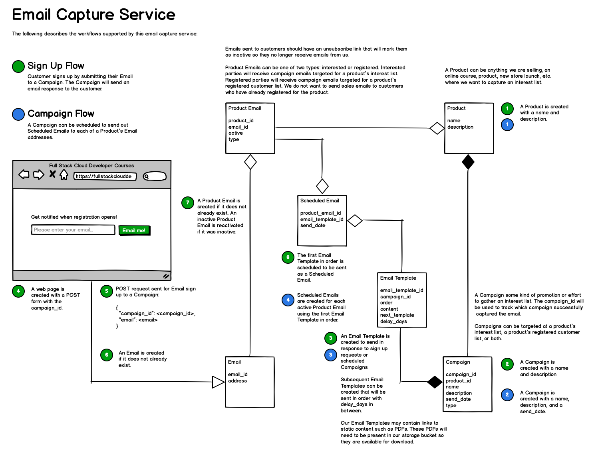

# Analysis of a System Diagram

I gave Claude 4 Sonnet an image and worked through a few prompts `Project Description > PRD > Task List > MVP > Task Descriptions` to end up with a 2-week MVP task list with descriptions for junior developers.

## Prompt: Analyze this diagram and tell me what it builds.



This diagram describes an **Email Marketing Automation System** with lead capture and campaign management capabilities. Here's what it builds:

## Core Components:

**1. Lead Capture System**
- A web-based email signup form (shown as "Full Stack Cloud Developer Courses" landing page)
- Captures visitor emails and creates customer records
- Sends POST requests to initiate email campaigns

**2. Email Campaign Management**
- Automated email sequences triggered by signups
- Scheduled email delivery system
- Email template management with customizable content
- Support for follow-up email sequences with configurable delays

**3. Product-Based Email Targeting**
- Links customers to specific products they're interested in
- Sends targeted emails based on product interest
- Manages both "interested" and "registered" customer segments
- Handles product-specific email campaigns

### Key Features:

- **Automated Workflows**: Triggers email sequences when customers sign up
- **Email Personalization**: Uses templates that can be customized per campaign
- **Unsubscribe Management**: Tracks inactive customers to comply with email regulations
- **Multi-Product Support**: Can handle campaigns for different products simultaneously
- **Scheduling System**: Manages when emails are sent with configurable delays

This system would typically be used by online course creators, SaaS companies, or digital product sellers to capture leads, nurture prospects, and convert them into customers through automated email marketing campaigns. The example shows it being used for a "Full Stack Cloud Developer Courses" business, but the architecture supports any product-based email marketing needs.

## Prompt: Create a PRD from this diagram.

## Email Capture Service - Product Requirements Document

### 1. Executive Summary

The Email Capture Service is an automated email marketing platform designed to capture leads, manage customer relationships, and deliver targeted email campaigns. The system enables businesses to convert website visitors into customers through strategic email sequences and product-based targeting.

### 2. Product Overview

#### 2.1 Vision
To provide a comprehensive email marketing automation platform that seamlessly captures leads and nurtures them through personalized email campaigns, ultimately driving product sales and customer engagement.

#### 2.2 Target Users
- Online course creators
- SaaS companies
- Digital product sellers
- E-commerce businesses
- Marketing teams requiring automated lead nurturing

### 3. Problem Statement

Businesses struggle with:
- Converting website visitors into qualified leads
- Managing complex email campaign sequences
- Personalizing email content based on customer interests
- Tracking customer engagement and campaign performance
- Maintaining compliance with email marketing regulations

### 4. Solution Overview

A comprehensive email capture and campaign management system that automates the entire customer journey from initial signup to product conversion through intelligent email sequences.

### 5. Feature Requirements

#### 5.1 Lead Capture System

##### 5.1.1 Email Signup Forms
- **Embeddable signup forms** for websites
- **Customizable form fields** (email, name, additional data)
- **POST API endpoint** for form submissions
- **Real-time validation** of email addresses
- **Responsive design** for mobile and desktop

##### 5.1.2 Landing Page Integration
- **Campaign-specific landing pages**
- **A/B testing capabilities** for form optimization
- **Custom branding** options
- **Analytics tracking** for conversion rates

#### 5.2 Customer Management

##### 5.2.1 Customer Records
- **Automatic customer creation** upon signup
- **Customer segmentation** (interested vs. registered)
- **Product interest tracking**
- **Email activity monitoring**
- **Unsubscribe management**

##### 5.2.2 Data Management
- **Duplicate email handling**
- **Customer data enrichment**
- **GDPR compliance** features
- **Data export capabilities**

#### 5.3 Campaign Management

##### 5.3.1 Email Campaigns
- **Automated campaign triggers** based on signup events
- **Multi-step email sequences**
- **Personalized email content**
- **Campaign scheduling and delays**
- **Template-based email creation**

##### 5.3.2 Email Templates
- **Drag-and-drop email builder**
- **Reusable template library**
- **Dynamic content insertion**
- **Mobile-responsive templates**
- **Template versioning**

#### 5.4 Product Integration

##### 5.4.1 Product Management
- **Product catalog management**
- **Product-specific email campaigns**
- **Interest-based customer segmentation**
- **Product performance tracking**

##### 5.4.2 Targeting Capabilities
- **Behavioral targeting** based on customer actions
- **Product recommendation engine**
- **Custom audience creation**
- **Cross-product campaign coordination**

#### 5.5 Automation Engine

##### 5.5.1 Workflow Automation
- **Visual workflow builder**
- **Conditional logic support**
- **Time-based triggers**
- **Event-driven automation**
- **Workflow performance monitoring**

##### 5.5.2 Scheduling System
- **Flexible email scheduling**
- **Timezone-aware delivery**
- **Send time optimization**
- **Delivery rate limiting**

### 6. Technical Requirements

#### 6.1 System Architecture
- **Microservices architecture** for scalability
- **RESTful API design**
- **Database optimization** for high-volume operations
- **Queue-based email processing**
- **Caching layer** for performance

#### 6.2 Integration Requirements
- **Third-party email service integration** (SendGrid, Mailgun, etc.)
- **CRM system connectors**
- **Analytics platform integration**
- **Webhook support** for external systems
- **API documentation** and SDKs

#### 6.3 Security Requirements
- **Data encryption** at rest and in transit
- **API authentication** and authorization
- **Rate limiting** and DDoS protection
- **Audit logging** for compliance
- **Secure email unsubscribe** mechanisms

### 7. User Experience Requirements

#### 7.1 Admin Dashboard
- **Campaign performance overview**
- **Real-time analytics dashboard**
- **Customer segment management**
- **Template library access**
- **System configuration tools**

#### 7.2 Email Experience
- **Professional email design**
- **Clear unsubscribe process**
- **Mobile-optimized rendering**
- **Fast loading times**
- **Consistent branding**

### 8. Performance Requirements

#### 8.1 Scalability
- **Support for 100K+ active subscribers**
- **10K+ emails per hour processing**
- **99.9% uptime SLA**
- **Auto-scaling capabilities**
- **Global content delivery**

#### 8.2 Response Times
- **API response time < 200ms**
- **Form submission processing < 1 second**
- **Email delivery within 5 minutes**
- **Dashboard load time < 3 seconds**

### 9. Compliance Requirements

#### 9.1 Email Regulations
- **CAN-SPAM Act compliance**
- **GDPR data protection**
- **One-click unsubscribe**
- **Email authentication** (SPF, DKIM, DMARC)
- **Bounce handling** and list hygiene

#### 9.2 Data Protection
- **Customer data anonymization**
- **Right to be forgotten** implementation
- **Data retention policies**
- **Consent management**

### 10. Success Metrics

#### 10.1 Business Metrics
- **Lead conversion rate**: Target 15% improvement
- **Email open rate**: Target 25% average
- **Click-through rate**: Target 5% average
- **Customer acquisition cost**: Target 20% reduction
- **Revenue per email**: Target $0.50

#### 10.2 Technical Metrics
- **Email delivery rate**: Target 99%
- **System uptime**: Target 99.9%
- **API response time**: Target <200ms
- **Processing throughput**: Target 10K emails/hour

### 11. Implementation Timeline

#### Phase 1 (Months 1-2): Core Infrastructure
- Basic email capture forms
- Customer management system
- Simple email campaigns
- Admin dashboard MVP

#### Phase 2 (Months 3-4): Advanced Features
- Email templates and builder
- Product integration
- Automation workflows
- Analytics and reporting

#### Phase 3 (Months 5-6): Optimization
- Advanced segmentation
- A/B testing capabilities
- Performance optimization
- Third-party integrations

### 12. Risk Assessment

#### 12.1 Technical Risks
- **Email deliverability challenges**
- **Scalability bottlenecks**
- **Third-party service dependencies**
- **Data migration complexity**

#### 12.2 Business Risks
- **Spam filter blocking**
- **Compliance violations**
- **Customer churn**
- **Competitive pressure**

### 13. Future Considerations

#### 13.1 Roadmap Items
- **AI-powered email optimization**
- **Advanced personalization**
- **Multi-channel marketing**
- **Social media integration**
- **Advanced analytics and ML**

#### 13.2 Scalability Planning
- **Multi-tenant architecture**
- **Global deployment**
- **Advanced automation**
- **Enterprise features**

### Notes

I've created a comprehensive Product Requirements Document (PRD) based on the email capture service diagram. The PRD covers all the key components shown in the diagram and expands them into a complete product specification.

The document includes:

- **Executive summary** and product vision
- **Detailed feature requirements** for each component (lead capture, customer management, campaigns, automation)
- **Technical specifications** including architecture, integrations, and security
- **Performance and compliance requirements**
- **Success metrics** and KPIs
- **Implementation timeline** with phased approach
- **Risk assessment** and mitigation strategies

The PRD translates the workflow diagram into actionable product requirements that a development team could use to build the email capture service. It maintains the core functionality shown in the diagram while adding the necessary business context, technical specifications, and success criteria needed for a complete product development initiative.

## Prompt: Create a task list from the PRD that maximizes parallelization.

## Email Capture Service - Parallelized Task List

### Task Organization Strategy

Tasks are organized into **parallel work streams** that can be executed simultaneously by different teams or individuals. Dependencies are clearly marked to ensure proper sequencing within each stream.

---

### 🏗️ **STREAM 1: Backend Infrastructure & APIs**

#### Phase 1A: Core Backend (Weeks 1-4)
- [ ] **Task 1.1**: Set up development environment and CI/CD pipeline
- [ ] **Task 1.2**: Design and implement database schema (Customer, Product, Email, Campaign tables)
- [ ] **Task 1.3**: Create RESTful API framework and authentication system
- [ ] **Task 1.4**: Implement customer management API endpoints (CRUD operations)
- [ ] **Task 1.5**: Build product management API endpoints
- [ ] **Task 1.6**: Set up logging, monitoring, and error handling infrastructure

#### Phase 1B: Email Processing (Weeks 3-6)
*Dependencies: Task 1.2, 1.3*
- [ ] **Task 1.7**: Implement email queue system and background job processing
- [ ] **Task 1.8**: Build email template management API
- [ ] **Task 1.9**: Create email sending service with third-party integration (SendGrid/Mailgun)
- [ ] **Task 1.10**: Implement email tracking and analytics collection
- [ ] **Task 1.11**: Build unsubscribe and bounce handling system

#### Phase 1C: Campaign Engine (Weeks 5-8)
*Dependencies: Task 1.4, 1.5, 1.7*
- [ ] **Task 1.12**: Implement campaign management API endpoints
- [ ] **Task 1.13**: Build automation workflow engine
- [ ] **Task 1.14**: Create scheduling system for delayed email delivery
- [ ] **Task 1.15**: Implement customer segmentation logic
- [ ] **Task 1.16**: Build campaign performance tracking

---

### 🎨 **STREAM 2: Frontend Development**

#### Phase 2A: Admin Dashboard (Weeks 1-6)
- [ ] **Task 2.1**: Set up frontend development environment (React/Vue.js)
- [ ] **Task 2.2**: Create design system and component library
- [ ] **Task 2.3**: Build authentication and navigation components
- [ ] **Task 2.4**: Implement customer management interface
- [ ] **Task 2.5**: Create product management dashboard
- [ ] **Task 2.6**: Build campaign creation and management interface

#### Phase 2B: Email Builder (Weeks 3-8)
*Dependencies: Task 2.2*
- [ ] **Task 2.7**: Design and implement drag-and-drop email builder
- [ ] **Task 2.8**: Create email template library interface
- [ ] **Task 2.9**: Build email preview and testing components
- [ ] **Task 2.10**: Implement template versioning and management
- [ ] **Task 2.11**: Create mobile-responsive email templates

#### Phase 2C: Analytics Dashboard (Weeks 5-8)
*Dependencies: Task 2.2, 2.3*
- [ ] **Task 2.12**: Build real-time analytics dashboard
- [ ] **Task 2.13**: Implement campaign performance visualization
- [ ] **Task 2.14**: Create customer segment analytics
- [ ] **Task 2.15**: Build A/B testing interface
- [ ] **Task 2.16**: Implement data export functionality

---

### 🌐 **STREAM 3: Integration & Embeddable Components**

#### Phase 3A: Signup Forms (Weeks 1-4)
- [ ] **Task 3.1**: Design embeddable signup form widget
- [ ] **Task 3.2**: Create JavaScript SDK for form integration
- [ ] **Task 3.3**: Build form customization options (styling, fields)
- [ ] **Task 3.4**: Implement form validation and error handling
- [ ] **Task 3.5**: Create form analytics and conversion tracking

#### Phase 3B: Landing Pages (Weeks 3-6)
*Dependencies: Task 3.1, 3.2*
- [ ] **Task 3.6**: Build landing page template system
- [ ] **Task 3.7**: Create A/B testing framework for landing pages
- [ ] **Task 3.8**: Implement SEO optimization features
- [ ] **Task 3.9**: Build landing page analytics
- [ ] **Task 3.10**: Create custom domain support

#### Phase 3C: Third-Party Integrations (Weeks 5-8)
- [ ] **Task 3.11**: Implement webhook system for external integrations
- [ ] **Task 3.12**: Build CRM integration connectors (Salesforce, HubSpot)
- [ ] **Task 3.13**: Create analytics platform integrations (Google Analytics)
- [ ] **Task 3.14**: Implement Zapier integration
- [ ] **Task 3.15**: Build API documentation and SDK

---

### 🔧 **STREAM 4: DevOps & Infrastructure**

#### Phase 4A: Core Infrastructure (Weeks 1-4)
- [ ] **Task 4.1**: Set up cloud infrastructure (AWS/GCP/Azure)
- [ ] **Task 4.2**: Configure container orchestration (Docker/Kubernetes)
- [ ] **Task 4.3**: Set up database clusters and replication
- [ ] **Task 4.4**: Implement caching layer (Redis/Memcached)
- [ ] **Task 4.5**: Configure load balancing and auto-scaling

#### Phase 4B: Security & Compliance (Weeks 2-6)
*Dependencies: Task 4.1*
- [ ] **Task 4.6**: Implement SSL/TLS encryption and security headers
- [ ] **Task 4.7**: Set up API rate limiting and DDoS protection
- [ ] **Task 4.8**: Configure backup and disaster recovery systems
- [ ] **Task 4.9**: Implement audit logging and compliance monitoring
- [ ] **Task 4.10**: Set up data encryption at rest and in transit

#### Phase 4C: Monitoring & Performance (Weeks 3-8)
*Dependencies: Task 4.1, 4.2*
- [ ] **Task 4.11**: Configure application monitoring (New Relic/DataDog)
- [ ] **Task 4.12**: Set up log aggregation and analysis
- [ ] **Task 4.13**: Implement performance monitoring and alerting
- [ ] **Task 4.14**: Create health check and status page systems
- [ ] **Task 4.15**: Set up automated testing and deployment pipelines

---

### 📋 **STREAM 5: Quality Assurance & Testing**

#### Phase 5A: Test Infrastructure (Weeks 1-3)
- [ ] **Task 5.1**: Set up test environments and data
- [ ] **Task 5.2**: Create automated testing framework
- [ ] **Task 5.3**: Implement unit test coverage for all components
- [ ] **Task 5.4**: Set up integration testing suite
- [ ] **Task 5.5**: Create performance testing framework

#### Phase 5B: Functional Testing (Weeks 4-7)
*Dependencies: Completion of corresponding development tasks*
- [ ] **Task 5.6**: Execute API endpoint testing
- [ ] **Task 5.7**: Perform email delivery and tracking testing
- [ ] **Task 5.8**: Test campaign automation workflows
- [ ] **Task 5.9**: Validate customer segmentation logic
- [ ] **Task 5.10**: Test form embedding and integration

#### Phase 5C: User Acceptance Testing (Weeks 6-8)
*Dependencies: Task 5.6-5.10*
- [ ] **Task 5.11**: Conduct admin dashboard usability testing
- [ ] **Task 5.12**: Test email builder functionality
- [ ] **Task 5.13**: Validate end-to-end customer journey
- [ ] **Task 5.14**: Perform cross-browser and device testing
- [ ] **Task 5.15**: Execute security and compliance testing

---

### 📚 **STREAM 6: Documentation & Training**

#### Phase 6A: Technical Documentation (Weeks 1-6)
- [ ] **Task 6.1**: Create API documentation and specifications
- [ ] **Task 6.2**: Write developer integration guides
- [ ] **Task 6.3**: Create deployment and operations documentation
- [ ] **Task 6.4**: Build troubleshooting and FAQ documentation
- [ ] **Task 6.5**: Create system architecture documentation

#### Phase 6B: User Documentation (Weeks 4-8)
*Dependencies: UI development completion*
- [ ] **Task 6.6**: Write user manuals and guides
- [ ] **Task 6.7**: Create video tutorials and walkthroughs
- [ ] **Task 6.8**: Build in-app help and tooltips
- [ ] **Task 6.9**: Create best practices and use case documentation
- [ ] **Task 6.10**: Develop training materials for customer success

---

### 🎯 **STREAM 7: Business & Compliance**

#### Phase 7A: Legal & Compliance (Weeks 1-4)
- [ ] **Task 7.1**: Review and implement GDPR compliance requirements
- [ ] **Task 7.2**: Ensure CAN-SPAM Act compliance
- [ ] **Task 7.3**: Create privacy policy and terms of service
- [ ] **Task 7.4**: Implement consent management system
- [ ] **Task 7.5**: Set up data retention and deletion policies

#### Phase 7B: Business Operations (Weeks 2-6)
- [ ] **Task 7.6**: Create customer onboarding process
- [ ] **Task 7.7**: Develop pricing and billing system
- [ ] **Task 7.8**: Set up customer support infrastructure
- [ ] **Task 7.9**: Create marketing and sales materials
- [ ] **Task 7.10**: Develop partnership and integration strategies

#### Phase 7C: Analytics & Metrics (Weeks 4-8)
*Dependencies: Core system completion*
- [ ] **Task 7.11**: Set up business intelligence and reporting
- [ ] **Task 7.12**: Implement success metrics tracking
- [ ] **Task 7.13**: Create performance dashboards for stakeholders
- [ ] **Task 7.14**: Develop customer success metrics
- [ ] **Task 7.15**: Set up competitive analysis framework

---

### 🔄 **Cross-Stream Dependencies**

#### Critical Path Dependencies:
1. **Database Schema** (Task 1.2) → **All API Development** (Tasks 1.4, 1.5, 1.12)
2. **API Framework** (Task 1.3) → **Frontend Development** (Stream 2)
3. **Component Library** (Task 2.2) → **All Frontend Components** (Stream 2)
4. **Email Queue System** (Task 1.7) → **Campaign Engine** (Tasks 1.12-1.16)
5. **Core Infrastructure** (Task 4.1) → **All Deployment Tasks** (Stream 4)

#### Integration Points:
- **Week 3**: Frontend begins integration with initial API endpoints
- **Week 5**: Email system integration with campaign engine
- **Week 6**: Full-stack integration testing begins
- **Week 7**: Third-party integrations and testing
- **Week 8**: Final integration and deployment preparation

---

### 📊 **Resource Allocation Recommendations**

#### Team Structure:
- **Stream 1**: 3-4 Backend Developers
- **Stream 2**: 2-3 Frontend Developers + 1 UI/UX Designer
- **Stream 3**: 2 Full-Stack Developers
- **Stream 4**: 2 DevOps Engineers
- **Stream 5**: 2 QA Engineers
- **Stream 6**: 1 Technical Writer
- **Stream 7**: 1 Business Analyst + 1 Compliance Specialist

#### Timeline: 8 weeks for MVP with maximum parallelization
#### Total Estimated Effort: 120-150 person-weeks across all streams

### Notes

I've created a comprehensive task list that maximizes parallelization by organizing work into **7 independent streams** that can run simultaneously. Here's the key structure:

### **Parallelization Strategy:**

1. **🏗️ Backend Infrastructure** - Core APIs and data processing
2. **🎨 Frontend Development** - Admin dashboard and user interfaces  
3. **🌐 Integration & Components** - Embeddable forms and third-party connectors
4. **🔧 DevOps & Infrastructure** - Cloud setup, security, and monitoring
5. **📋 Quality Assurance** - Testing frameworks and validation
6. **📚 Documentation** - Technical and user documentation
7. **🎯 Business & Compliance** - Legal requirements and operations

### **Key Benefits:**

- **Maximum Concurrency**: 7 teams can work simultaneously
- **Clear Dependencies**: Each task shows what must be completed first
- **Flexible Resource Allocation**: Teams can be scaled up/down per stream
- **Risk Mitigation**: If one stream is blocked, others continue
- **Early Integration**: Integration points are scheduled throughout development

### **Timeline Optimization:**
- **8-week MVP delivery** with proper parallelization
- **Critical path clearly identified** to avoid bottlenecks
- **Integration checkpoints** every 2-3 weeks to ensure alignment
- **120-150 person-weeks** total effort distributed across streams

This approach allows you to significantly reduce time-to-market while maintaining quality and ensuring all components integrate properly. Each stream can operate independently while staying synchronized through defined integration points.

## Prompt: Task out just the MVP in the order the tasks should be in considering dependencies and parallelization.

## Email Capture Service - MVP Task Order

### MVP Scope Definition
**Core Features Only:**
- Basic email signup forms
- Customer management
- Simple email campaigns
- Basic admin dashboard
- Essential infrastructure

**Timeline:** 6 weeks | **Team Size:** 8-10 people

---

### 📅 **WEEK 1: Foundation Setup**

#### Day 1-2: Critical Foundation (Sequential)
1. **Setup Development Environment** *(DevOps)*
   - Repository setup, CI/CD pipeline
   - Development, staging environments
   
2. **Database Schema Design** *(Backend Lead)*
   - Customer, Product, Email, Campaign tables
   - Relationships and constraints

#### Day 3-5: Parallel Foundation Work
**Stream A - Backend Core** *(2 Backend Devs)*
3. **API Framework Setup**
   - REST API structure
   - Authentication system
   - Basic middleware

4. **Customer Management API**
   - CRUD endpoints for customers
   - Email validation
   - Basic segmentation

**Stream B - Frontend Setup** *(2 Frontend Devs)*
5. **Frontend Environment Setup**
   - React/Vue.js project initialization
   - Component library setup
   - Basic routing

6. **Design System Creation**
   - UI component library
   - Style guide and themes
   - Reusable components

**Stream C - Infrastructure** *(1 DevOps)*
7. **Cloud Infrastructure Setup**
   - Database deployment
   - Basic security configuration
   - Load balancing setup

---

### 📅 **WEEK 2: Core Backend & Email Infrastructure**

#### Parallel Development Streams

**Stream A - Email System** *(2 Backend Devs)*
8. **Email Queue System** *(Depends on: Task 3)*
   - Background job processing
   - Queue management
   - Error handling

9. **Email Service Integration**
   - SendGrid/Mailgun integration
   - Email template processing
   - Delivery tracking

**Stream B - Campaign Engine** *(1 Backend Dev)*
10. **Campaign Management API** *(Depends on: Task 4)*
    - Campaign CRUD operations
    - Basic automation triggers
    - Email scheduling

**Stream C - Frontend Core** *(2 Frontend Devs)*
11. **Authentication UI** *(Depends on: Task 5, 6)*
    - Login/signup forms
    - Session management
    - Protected routes

12. **Customer Management Interface** *(Depends on: Task 4, 11)*
    - Customer list view
    - Basic filtering
    - Customer details

**Stream D - Signup Forms** *(1 Full-stack Dev)*
13. **Basic Signup Form** *(Depends on: Task 4)*
    - HTML/JS form widget
    - API integration
    - Basic validation

---

### 📅 **WEEK 3: Integration & Email Features**

#### Parallel Development Streams

**Stream A - Email Templates** *(1 Backend Dev + 1 Frontend Dev)*
14. **Email Template System** *(Depends on: Task 9)*
    - Template storage and management
    - Basic template editor
    - Template rendering

15. **Email Template UI** *(Depends on: Task 12, 14)*
    - Template library interface
    - Simple template editor
    - Preview functionality

**Stream B - Campaign Features** *(1 Backend Dev + 1 Frontend Dev)*
16. **Campaign Automation** *(Depends on: Task 10)*
    - Trigger-based email sending
    - Basic scheduling
    - Campaign status tracking

17. **Campaign Management UI** *(Depends on: Task 12, 16)*
    - Campaign creation form
    - Campaign list view
    - Basic analytics display

**Stream C - Form Enhancement** *(1 Full-stack Dev)*
18. **Form Embedding System** *(Depends on: Task 13)*
    - JavaScript SDK
    - Customization options
    - Integration documentation

**Stream D - Infrastructure** *(1 DevOps)*
19. **Monitoring & Logging** *(Depends on: Task 7)*
    - Application monitoring
    - Error tracking
    - Performance metrics

---

### 📅 **WEEK 4: Dashboard & Email Processing**

#### Parallel Development Streams

**Stream A - Email Processing** *(2 Backend Devs)*
20. **Email Delivery Engine** *(Depends on: Task 8, 9)*
    - Batch email processing
    - Delivery status tracking
    - Bounce handling

21. **Analytics Collection** *(Depends on: Task 20)*
    - Email open/click tracking
    - Campaign performance metrics
    - Customer engagement data

**Stream B - Dashboard Core** *(2 Frontend Devs)*
22. **Admin Dashboard Layout** *(Depends on: Task 11)*
    - Navigation structure
    - Dashboard framework
    - Responsive design

23. **Basic Analytics Dashboard** *(Depends on: Task 21, 22)*
    - Campaign performance display
    - Customer statistics
    - Email delivery metrics

**Stream C - Customer Features** *(1 Backend Dev)*
24. **Customer Segmentation** *(Depends on: Task 4)*
    - Basic segment creation
    - Interest-based grouping
    - Segment API endpoints

**Stream D - Testing Setup** *(1 QA Engineer)*
25. **Test Framework Setup** *(Depends on: Task 3)*
    - Automated testing setup
    - Test data creation
    - Testing environment

---

### 📅 **WEEK 5: Integration & Polish**

#### Parallel Development Streams

**Stream A - Feature Integration** *(2 Backend Devs)*
26. **Customer Segmentation UI** *(Depends on: Task 24, 22)*
    - Segment creation interface
    - Customer assignment
    - Segment management

27. **Email Campaign Integration** *(Depends on: Task 16, 20)*
    - End-to-end campaign flow
    - Automated email sequences
    - Campaign performance tracking

**Stream B - Form & Landing Pages** *(2 Frontend Devs)*
28. **Form Analytics** *(Depends on: Task 18, 21)*
    - Conversion tracking
    - Form performance metrics
    - A/B testing basics

29. **Basic Landing Pages** *(Depends on: Task 18)*
    - Simple landing page templates
    - Form integration
    - Mobile responsiveness

**Stream C - Security & Compliance** *(1 DevOps + 1 Backend Dev)*
30. **Security Implementation** *(Depends on: Task 7, 19)*
    - SSL/TLS configuration
    - API security hardening
    - Data encryption

31. **Unsubscribe System** *(Depends on: Task 20)*
    - One-click unsubscribe
    - Compliance tracking
    - Customer preference management

**Stream D - Testing** *(1 QA Engineer)*
32. **Integration Testing** *(Depends on: Task 25, 27)*
    - End-to-end testing
    - API integration tests
    - User workflow validation

---

### 📅 **WEEK 6: Final Integration & Deployment**

#### Sequential Tasks for Deployment

**Days 1-2: Final Integration** *(All Streams)*
33. **System Integration** *(Depends on: All previous tasks)*
    - Connect all components
    - Data flow validation
    - Cross-system testing

34. **Performance Optimization** *(Backend + DevOps)*
    - Database query optimization
    - API response time improvement
    - Caching implementation

**Days 3-4: Testing & Bug Fixes** *(All Streams)*
35. **User Acceptance Testing** *(QA + Frontend)*
    - End-to-end user scenarios
    - UI/UX validation
    - Cross-browser testing

36. **Bug Fixes & Polish** *(All Streams)*
    - Critical bug resolution
    - UI polish and refinement
    - Performance fixes

**Day 5: Deployment Preparation** *(DevOps + Backend)*
37. **Production Environment Setup**
    - Production infrastructure
    - Database migration
    - Security configuration

38. **Deployment & Monitoring Setup**
    - Application deployment
    - Monitoring configuration
    - Health checks

---

### 🔄 **Critical Dependencies Summary**

#### Foundation Dependencies (Week 1):
- **Task 1** → **Task 2** → **All other tasks**
- **Task 3** → **All backend API tasks**
- **Task 5, 6** → **All frontend tasks**

#### Core System Dependencies (Week 2-3):
- **Task 4** → **Tasks 10, 12, 13, 24**
- **Task 8, 9** → **Tasks 14, 16, 20**
- **Task 11** → **Tasks 15, 17, 22**

#### Integration Dependencies (Week 4-5):
- **Task 20, 21** → **Tasks 23, 27, 28**
- **Task 22** → **Tasks 23, 26**
- **Task 16, 20** → **Task 27**

#### Final Dependencies (Week 6):
- **All previous tasks** → **Task 33**
- **Task 33** → **Tasks 34, 35**
- **Task 35** → **Task 36**
- **Task 36** → **Tasks 37, 38**

---

### 👥 **Team Allocation**

#### Core Team (8-10 people):
- **2-3 Backend Developers**
- **2 Frontend Developers**
- **1 Full-Stack Developer**
- **1 DevOps Engineer**
- **1 QA Engineer**
- **1 UI/UX Designer** (part-time)

#### Work Distribution:
- **Backend**: 40% of effort
- **Frontend**: 35% of effort
- **DevOps**: 15% of effort
- **QA**: 10% of effort

#### Weekly Capacity:
- **Week 1**: 80% foundation, 20% parallel work
- **Week 2-4**: 90% parallel work, 10% integration
- **Week 5**: 70% parallel work, 30% integration
- **Week 6**: 100% integration and deployment

---

### 🎯 **MVP Success Criteria**

#### Functional Requirements:
✅ **Email signup forms** can be embedded on websites  
✅ **Customer management** with basic segmentation  
✅ **Email campaigns** can be created and sent  
✅ **Admin dashboard** for managing all components  
✅ **Email tracking** for opens, clicks, and deliveries  
✅ **Unsubscribe system** for compliance  

#### Technical Requirements:
✅ **99% uptime** during testing period  
✅ **API response times** under 500ms  
✅ **Email delivery** within 10 minutes  
✅ **Mobile-responsive** forms and dashboard  
✅ **Basic security** and data protection  

#### Business Requirements:
✅ **End-to-end customer journey** from signup to email delivery  
✅ **Compliance** with basic email regulations  
✅ **Scalable architecture** for future growth  
✅ **Documentation** for API and user guides

### Notes

I've created a focused MVP task list that balances dependencies with maximum parallelization. Here's the key structure:

### **MVP Strategy:**

**🎯 6-week timeline** with 8-10 person team
**⚡ 70% parallel work** across weeks 2-5
**🔄 Clear dependency chain** to avoid bottlenecks

### **Key Optimizations:**

1. **Week 1**: Essential foundation work (database, API framework, frontend setup)
2. **Weeks 2-4**: Maximum parallelization (4 streams working simultaneously)
3. **Week 5**: Integration-heavy with continued parallel work
4. **Week 6**: Sequential integration and deployment

### **Dependency Management:**

- **Critical path**: Database → API Framework → Customer Management → Campaign System
- **Parallel streams**: Email system, frontend development, forms, infrastructure
- **Integration points**: Week 3, 5, and 6 for system coordination

### **Resource Allocation:**

- **Backend developers**: Focus on core API and email processing
- **Frontend developers**: Dashboard and user interfaces
- **Full-stack developer**: Embeddable forms and integrations
- **DevOps engineer**: Infrastructure and deployment
- **QA engineer**: Testing framework and validation

This approach delivers a functional MVP in 6 weeks while maintaining code quality and ensuring all components integrate properly. The parallelization reduces the timeline from what would be 12+ weeks if done sequentially.

## Prompt: What can be built in two weeks if tasks that can be done manually for now were done by a person?

## 2-Week MVP: Core Email Capture with Manual Operations

### 🎯 **What Gets Built (Automated)**

#### **Week 1: Core Foundation** 
- ✅ **Email signup forms** that capture leads
- ✅ **Basic customer database** storage
- ✅ **Simple admin dashboard** to view customers
- ✅ **Email sending capability** (via SendGrid/Mailgun)
- ✅ **Basic form embedding** for websites

#### **Week 2: Essential Features**
- ✅ **Email template system** (basic)
- ✅ **Campaign creation interface**
- ✅ **Customer segmentation** (manual triggers)
- ✅ **Email tracking** (opens, clicks)
- ✅ **Unsubscribe functionality**

### 📋 **What Gets Done Manually**

#### **Campaign Management** (Instead of automation)
- 👤 **Manual email scheduling**: Person clicks "Send Now" instead of automated triggers
- 👤 **Manual segmentation**: Person selects customer groups manually
- 👤 **Manual follow-ups**: Person creates and sends sequence emails manually
- 👤 **Manual A/B testing**: Person creates variants and chooses winners manually

#### **Customer Operations** (Instead of advanced automation)
- 👤 **Manual customer categorization**: Person tags customers as "interested" vs "registered"
- 👤 **Manual list hygiene**: Person reviews bounces and unsubscribes
- 👤 **Manual product assignment**: Person assigns customers to product interest groups
- 👤 **Manual campaign analysis**: Person reviews metrics and creates reports

#### **Content Management** (Instead of advanced tools)
- 👤 **Manual template creation**: Person writes HTML emails instead of drag-and-drop builder
- 👤 **Manual personalization**: Person uses simple merge tags instead of complex logic
- 👤 **Manual content approval**: Person reviews emails before sending
- 👤 **Manual compliance checking**: Person ensures emails meet legal requirements

---

### 🛠️ **2-Week Development Plan**

#### **Week 1: Days 1-7**

##### **Day 1-2: Foundation (Sequential)**
1. **Setup Development Environment** *(1 DevOps)*
2. **Database Schema** *(1 Backend)*
   - Customer table (email, name, status, created_at)
   - Email table (subject, content, sent_at, campaign_id)
   - Campaign table (name, status, created_at)

##### **Day 3-7: Parallel Development**

**Stream A - Backend Core** *(2 Backend Devs)*
3. **Basic API Framework**
   - REST endpoints for customers, emails, campaigns
   - Simple authentication (API keys)
   - Basic CRUD operations

4. **Email Integration**
   - SendGrid/Mailgun setup
   - Send email function
   - Basic email templates

**Stream B - Frontend** *(2 Frontend Devs)*
5. **Admin Dashboard MVP**
   - Customer list view
   - Basic email sending interface
   - Simple campaign creation

6. **Signup Form Widget**
   - Embeddable JavaScript form
   - Basic styling options
   - Form validation

**Stream C - Infrastructure** *(1 DevOps)*
7. **Basic Deployment**
   - Simple cloud hosting
   - Database setup
   - Basic security

#### **Week 2: Days 8-14**

##### **Day 8-12: Feature Development**

**Stream A - Email Features** *(2 Backend Devs)*
8. **Email Tracking System**
   - Open/click tracking pixels
   - Basic analytics collection
   - Unsubscribe links

9. **Template System**
   - HTML template storage
   - Simple merge tag support
   - Template preview

**Stream B - Dashboard Enhancement** *(2 Frontend Devs)*
10. **Campaign Management UI**
    - Campaign creation form
    - Email composition interface
    - Send campaign button

11. **Analytics Dashboard**
    - Basic email metrics display
    - Customer list with segments
    - Campaign performance view

**Stream C - Customer Management** *(1 Backend Dev)*
12. **Customer Segmentation**
    - Manual tagging system
    - Basic filtering
    - Export functionality

##### **Day 13-14: Integration & Testing**
13. **System Integration** *(All developers)*
14. **Basic Testing & Bug Fixes** *(All developers)*

---

### 🎯 **Deliverable: Functional System**

#### **What Works End-to-End:**
1. **Lead Capture Flow:**
   - Customer fills form on website
   - Data saves to database
   - Appears in admin dashboard

2. **Manual Email Campaign:**
   - Person creates campaign in dashboard
   - Person selects customers manually
   - Person writes email content
   - Person clicks "Send Now"
   - Emails delivered via SendGrid/Mailgun

3. **Basic Analytics:**
   - Person views open/click rates
   - Person sees customer list
   - Person exports data

#### **Manual Workflow Example:**
```
Daily Operations (30 minutes):
1. Check new signups in dashboard
2. Tag customers as "interested" or "registered"
3. Create email campaign for specific segment
4. Write email content with merge tags
5. Preview email and send to selected customers
6. Review email performance metrics
```

---

### 💰 **Cost-Benefit Analysis**

#### **Development Savings:**
- **Automation Engine**: 3-4 weeks → Manual process
- **Advanced Segmentation**: 2 weeks → Manual tagging
- **Email Builder**: 2 weeks → HTML editing
- **Workflow Designer**: 2-3 weeks → Manual triggers
- **Advanced Analytics**: 1-2 weeks → Basic metrics

#### **Operational Cost:**
- **Manual Operations**: 30-60 minutes/day
- **Suitable for**: Up to 1,000 customers, 10 campaigns/month
- **Person Required**: Marketing coordinator or VA

#### **When to Automate:**
- **Customer Count**: >1,000 active subscribers
- **Campaign Volume**: >20 campaigns/month
- **Team Size**: >2 marketers using system
- **Revenue**: >$10K/month from email marketing

---

### 🚀 **Technical Implementation**

#### **Architecture Simplification:**
```
Frontend (React) → REST API → Database
                 ↓
            Email Service (SendGrid)
```

#### **Database Schema (Minimal):**
```sql
customers: id, email, name, status, tags, created_at
campaigns: id, name, subject, content, status, created_at
emails: id, customer_id, campaign_id, sent_at, opened_at, clicked_at
```

#### **Key Features:**
- **Forms**: Basic JavaScript widget
- **Dashboard**: Simple React admin panel
- **Email**: Direct SendGrid API integration
- **Tracking**: Basic pixel tracking
- **Auth**: Simple API key authentication

---

### 📊 **Manual Process Workflows**

#### **Daily Lead Management (15 minutes):**
1. Review new signups
2. Tag customers by interest
3. Add notes or flags
4. Export high-value leads

#### **Weekly Campaign Creation (30 minutes):**
1. Select customer segment
2. Write email content
3. Add merge tags for personalization
4. Preview and test email
5. Schedule or send immediately

#### **Monthly Analytics Review (45 minutes):**
1. Export campaign performance data
2. Analyze open/click rates
3. Identify top-performing content
4. Clean up bounced emails
5. Plan next month's campaigns

---

### 🎯 **Success Metrics**

#### **Technical KPIs:**
- ✅ **Form submissions** successfully captured
- ✅ **Email delivery rate** >95%
- ✅ **Dashboard uptime** >99%
- ✅ **Page load time** <3 seconds

#### **Business KPIs:**
- ✅ **Lead capture rate** from embedded forms
- ✅ **Email open rate** >20%
- ✅ **Click-through rate** >3%
- ✅ **Manual operation time** <1 hour/day

#### **Validation Criteria:**
- ✅ **End-to-end flow** works without errors
- ✅ **Manual operations** can be performed by non-technical person
- ✅ **System scales** to 500+ customers without performance issues
- ✅ **Compliance** with basic email regulations

---

### 🔄 **Automation Roadmap**

#### **Phase 2 (Weeks 3-4): Basic Automation**
- Drip campaigns (simple sequences)
- Automated welcome emails
- Basic triggers (signup, purchase)

#### **Phase 3 (Weeks 5-8): Advanced Features**
- Visual email builder
- Advanced segmentation
- A/B testing automation
- Performance optimization

#### **Phase 4 (Weeks 9-12): Scale Features**
- Multi-channel campaigns
- Advanced analytics
- Integration marketplace
- Enterprise features

This approach gets you a **functional email capture system in 2 weeks** with the flexibility to scale automation as your business grows. The manual processes are actually beneficial for learning what works before automating it!

### Notes

I've created a realistic 2-week MVP plan that strategically uses manual processes to dramatically reduce development time while still delivering a functional system.

### **🎯 Core Strategy:**

**Build the technical foundation** (automated) while **deferring complex automation** (manual) to reduce development from 6 weeks to 2 weeks.

### **✅ What Gets Built (Automated):**
- Email signup forms with database storage
- Basic admin dashboard
- Email sending capability
- Simple customer management
- Email tracking and analytics

### **👤 What Gets Done Manually:**
- Campaign scheduling and triggers
- Customer segmentation and tagging
- Email content creation and approval
- A/B testing and optimization
- Performance analysis and reporting

### **🚀 Key Benefits:**

1. **Speed**: 2 weeks vs 6 weeks development time
2. **Learning**: Manual processes reveal what should be automated
3. **Flexibility**: Easy to pivot based on real usage patterns
4. **Cost**: 70% less development effort upfront
5. **Validation**: Proves business model before heavy automation investment

### **📊 Operational Reality:**

- **Daily time commitment**: 30-60 minutes for manual tasks
- **Suitable scale**: Up to 1,000 customers, 10 campaigns/month
- **Staff requirement**: 1 marketing coordinator or VA
- **Break-even point**: When manual time exceeds automation development ROI

### **🔄 Evolution Path:**

The system is designed to gradually automate manual processes as you scale:
- **Week 3-4**: Add basic automation (drip campaigns)
- **Week 5-8**: Advanced features (email builder, segmentation)
- **Week 9-12**: Scale features (multi-channel, enterprise)

This approach gets you **revenue-generating functionality in 2 weeks** while building toward full automation as your business grows and validates the need for each feature.

## Prompt: Create a task list with descriptions that can be given to a junior developer for each of the MVP items.

## 2-Week MVP: Junior Developer Task List

### 📋 **Task Format**
Each task includes:
- **Clear objective** and deliverable
- **Technical requirements** and constraints
- **Step-by-step guidance** for implementation
- **Testing criteria** and acceptance requirements
- **Resources** and examples

---

### 🏗️ **WEEK 1: FOUNDATION TASKS**

#### **Task 1.1: Project Setup and Development Environment**
**Assigned to:** DevOps/Backend Junior Developer  
**Duration:** 1 day  
**Dependencies:** None  

##### **Objective:**
Set up the complete development environment and project structure for the email capture service.

##### **Technical Requirements:**
- Node.js backend with Express.js framework
- React frontend application
- PostgreSQL database
- Git repository with proper branching strategy
- Basic CI/CD pipeline

##### **Step-by-Step Implementation:**

1. **Initialize Backend Project:**
   ```bash
   mkdir email-capture-backend
   cd email-capture-backend
   npm init -y
   npm install express cors helmet morgan dotenv bcryptjs jsonwebtoken
   npm install nodemailer @sendgrid/mail
   npm install pg sequelize
   npm install --save-dev nodemon jest supertest
   ```

2. **Create Project Structure:**
   ```
   backend/
   ├── src/
   │   ├── controllers/
   │   ├── models/
   │   ├── routes/
   │   ├── middleware/
   │   ├── config/
   │   └── utils/
   ├── tests/
   ├── package.json
   └── .env.example
   ```

3. **Initialize Frontend Project:**
   ```bash
   npx create-react-app email-capture-frontend
   cd email-capture-frontend
   npm install axios react-router-dom
   npm install tailwindcss @tailwindcss/forms
   ```

4. **Setup Database:**
   - Install PostgreSQL locally or use Docker
   - Create development database
   - Configure database connection in backend

5. **Environment Configuration:**
   - Create `.env` files for both frontend and backend
   - Add database connection strings
   - Add email service API keys (placeholder)

##### **Deliverables:**
- [ ] Both frontend and backend projects run locally
- [ ] Database connection established
- [ ] Git repository created with initial commit
- [ ] Environment variables configured
- [ ] Basic npm scripts work (start, dev, test)

##### **Testing Criteria:**
- `npm start` works for both projects
- Database connection test passes
- No console errors on startup
- Git commits are properly formatted

---

#### **Task 1.2: Database Schema Design and Models**
**Assigned to:** Backend Junior Developer  
**Duration:** 1 day  
**Dependencies:** Task 1.1  

##### **Objective:**
Create the database schema and Sequelize models for customers, campaigns, and emails.

##### **Technical Requirements:**
- Use Sequelize ORM with PostgreSQL
- Implement proper relationships between models
- Add validation and constraints
- Create database migrations

##### **Step-by-Step Implementation:**

1. **Install and Configure Sequelize:**
   ```bash
   npm install sequelize-cli
   npx sequelize-cli init
   ```

2. **Create Models:**
   ```javascript
   // models/Customer.js
   const { DataTypes } = require('sequelize');
   
   module.exports = (sequelize) => {
     const Customer = sequelize.define('Customer', {
       id: {
         type: DataTypes.UUID,
         defaultValue: DataTypes.UUIDV4,
         primaryKey: true
       },
       email: {
         type: DataTypes.STRING,
         allowNull: false,
         unique: true,
         validate: { isEmail: true }
       },
       name: {
         type: DataTypes.STRING,
         allowNull: true
       },
       status: {
         type: DataTypes.ENUM('active', 'inactive', 'unsubscribed'),
         defaultValue: 'active'
       },
       tags: {
         type: DataTypes.ARRAY(DataTypes.STRING),
         defaultValue: []
       }
     });
     return Customer;
   };
   ```

3. **Create Campaign Model:**
   ```javascript
   // models/Campaign.js
   const Campaign = sequelize.define('Campaign', {
     id: { type: DataTypes.UUID, defaultValue: DataTypes.UUIDV4, primaryKey: true },
     name: { type: DataTypes.STRING, allowNull: false },
     subject: { type: DataTypes.STRING, allowNull: false },
     content: { type: DataTypes.TEXT, allowNull: false },
     status: { type: DataTypes.ENUM('draft', 'sent', 'scheduled'), defaultValue: 'draft' }
   });
   ```

4. **Create Email Model:**
   ```javascript
   // models/Email.js
   const Email = sequelize.define('Email', {
     id: { type: DataTypes.UUID, defaultValue: DataTypes.UUIDV4, primaryKey: true },
     sentAt: { type: DataTypes.DATE },
     openedAt: { type: DataTypes.DATE },
     clickedAt: { type: DataTypes.DATE },
     status: { type: DataTypes.ENUM('pending', 'sent', 'failed'), defaultValue: 'pending' }
   });
   ```

5. **Define Relationships:**
   ```javascript
   // models/index.js
   Customer.hasMany(Email);
   Email.belongsTo(Customer);
   Campaign.hasMany(Email);
   Email.belongsTo(Campaign);
   ```

6. **Create Migrations:**
   ```bash
   npx sequelize-cli migration:generate --name create-customers
   npx sequelize-cli migration:generate --name create-campaigns
   npx sequelize-cli migration:generate --name create-emails
   ```

##### **Deliverables:**
- [ ] All models created with proper validations
- [ ] Database migrations written and tested
- [ ] Model relationships properly defined
- [ ] Database seeds for test data
- [ ] Basic CRUD operations tested

##### **Testing Criteria:**
- Migrations run successfully
- Models can be created, read, updated, deleted
- Foreign key relationships work correctly
- Validation rules prevent invalid data

---

#### **Task 1.3: Basic API Framework and Authentication**
**Assigned to:** Backend Junior Developer  
**Duration:** 1 day  
**Dependencies:** Task 1.2  

##### **Objective:**
Create a RESTful API framework with basic authentication and middleware.

##### **Technical Requirements:**
- Express.js with proper middleware
- JWT-based authentication
- API key authentication for external requests
- Input validation and error handling
- CORS configuration

##### **Step-by-Step Implementation:**

1. **Setup Express Server:**
   ```javascript
   // src/app.js
   const express = require('express');
   const cors = require('cors');
   const helmet = require('helmet');
   const morgan = require('morgan');
   
   const app = express();
   
   // Middleware
   app.use(helmet());
   app.use(cors());
   app.use(morgan('combined'));
   app.use(express.json());
   app.use(express.urlencoded({ extended: true }));
   
   // Routes
   app.use('/api/customers', require('./routes/customers'));
   app.use('/api/campaigns', require('./routes/campaigns'));
   app.use('/api/emails', require('./routes/emails'));
   
   module.exports = app;
   ```

2. **Create Authentication Middleware:**
   ```javascript
   // middleware/auth.js
   const jwt = require('jsonwebtoken');
   
   const authenticateToken = (req, res, next) => {
     const authHeader = req.headers['authorization'];
     const token = authHeader && authHeader.split(' ')[1];
   
     if (!token) {
       return res.status(401).json({ error: 'Access token required' });
     }
   
     jwt.verify(token, process.env.JWT_SECRET, (err, user) => {
       if (err) return res.status(403).json({ error: 'Invalid token' });
       req.user = user;
       next();
     });
   };
   
   module.exports = { authenticateToken };
   ```

3. **Create API Key Authentication:**
   ```javascript
   // middleware/apiAuth.js
   const authenticateApiKey = (req, res, next) => {
     const apiKey = req.headers['x-api-key'];
     
     if (!apiKey || apiKey !== process.env.API_KEY) {
       return res.status(401).json({ error: 'Valid API key required' });
     }
     
     next();
   };
   
   module.exports = { authenticateApiKey };
   ```

4. **Create Error Handling Middleware:**
   ```javascript
   // middleware/errorHandler.js
   const errorHandler = (err, req, res, next) => {
     console.error(err.stack);
     
     if (err.name === 'SequelizeValidationError') {
       return res.status(400).json({
         error: 'Validation error',
         details: err.errors.map(e => ({ field: e.path, message: e.message }))
       });
     }
     
     res.status(500).json({ error: 'Internal server error' });
   };
   
   module.exports = errorHandler;
   ```

5. **Create Basic Route Structure:**
   ```javascript
   // routes/customers.js
   const express = require('express');
   const router = express.Router();
   const { authenticateApiKey } = require('../middleware/apiAuth');
   
   router.get('/', authenticateApiKey, (req, res) => {
     res.json({ message: 'Customers endpoint' });
   });
   
   module.exports = router;
   ```

##### **Deliverables:**
- [ ] Express server runs without errors
- [ ] Authentication middleware implemented
- [ ] API key authentication working
- [ ] Basic route structure created
- [ ] Error handling middleware functional
- [ ] CORS properly configured

##### **Testing Criteria:**
- Server starts and responds to requests
- Authentication middleware blocks unauthorized requests
- API key authentication works correctly
- Error handling returns proper HTTP status codes
- CORS allows frontend requests

---

#### **Task 1.4: Customer Management API Endpoints**
**Assigned to:** Backend Junior Developer  
**Duration:** 1 day  
**Dependencies:** Task 1.3  

##### **Objective:**
Create full CRUD API endpoints for customer management with validation and error handling.

##### **Technical Requirements:**
- RESTful API endpoints for customers
- Input validation and sanitization
- Proper HTTP status codes
- Error handling and logging
- Query parameters for filtering and pagination

##### **Step-by-Step Implementation:**

1. **Create Customer Controller:**
   ```javascript
   // controllers/customerController.js
   const { Customer } = require('../models');
   const { Op } = require('sequelize');
   
   const customerController = {
     // GET /api/customers
     getAllCustomers: async (req, res) => {
       try {
         const { page = 1, limit = 10, status, tags } = req.query;
         const offset = (page - 1) * limit;
         
         const where = {};
         if (status) where.status = status;
         if (tags) where.tags = { [Op.contains]: [tags] };
         
         const customers = await Customer.findAndCountAll({
           where,
           limit: parseInt(limit),
           offset: parseInt(offset),
           order: [['createdAt', 'DESC']]
         });
         
         res.json({
           customers: customers.rows,
           total: customers.count,
           page: parseInt(page),
           totalPages: Math.ceil(customers.count / limit)
         });
       } catch (error) {
         res.status(500).json({ error: error.message });
       }
     },
   
     // POST /api/customers
     createCustomer: async (req, res) => {
       try {
         const { email, name, tags } = req.body;
         
         // Validation
         if (!email) {
           return res.status(400).json({ error: 'Email is required' });
         }
         
         const customer = await Customer.create({
           email: email.toLowerCase().trim(),
           name: name?.trim(),
           tags: tags || []
         });
         
         res.status(201).json(customer);
       } catch (error) {
         if (error.name === 'SequelizeUniqueConstraintError') {
           return res.status(409).json({ error: 'Email already exists' });
         }
         res.status(500).json({ error: error.message });
       }
     },
   
     // GET /api/customers/:id
     getCustomer: async (req, res) => {
       try {
         const customer = await Customer.findByPk(req.params.id);
         if (!customer) {
           return res.status(404).json({ error: 'Customer not found' });
         }
         res.json(customer);
       } catch (error) {
         res.status(500).json({ error: error.message });
       }
     },
   
     // PUT /api/customers/:id
     updateCustomer: async (req, res) => {
       try {
         const customer = await Customer.findByPk(req.params.id);
         if (!customer) {
           return res.status(404).json({ error: 'Customer not found' });
         }
         
         const { name, status, tags } = req.body;
         await customer.update({
           name: name?.trim(),
           status,
           tags: tags || customer.tags
         });
         
         res.json(customer);
       } catch (error) {
         res.status(500).json({ error: error.message });
       }
     },
   
     // DELETE /api/customers/:id
     deleteCustomer: async (req, res) => {
       try {
         const customer = await Customer.findByPk(req.params.id);
         if (!customer) {
           return res.status(404).json({ error: 'Customer not found' });
         }
         
         await customer.destroy();
         res.status(204).send();
       } catch (error) {
         res.status(500).json({ error: error.message });
       }
     }
   };
   
   module.exports = customerController;
   ```

2. **Update Customer Routes:**
   ```javascript
   // routes/customers.js
   const express = require('express');
   const router = express.Router();
   const customerController = require('../controllers/customerController');
   const { authenticateApiKey } = require('../middleware/apiAuth');
   
   // Apply authentication to all routes
   router.use(authenticateApiKey);
   
   router.get('/', customerController.getAllCustomers);
   router.post('/', customerController.createCustomer);
   router.get('/:id', customerController.getCustomer);
   router.put('/:id', customerController.updateCustomer);
   router.delete('/:id', customerController.deleteCustomer);
   
   module.exports = router;
   ```

3. **Create Input Validation Middleware:**
   ```javascript
   // middleware/validation.js
   const { body, validationResult } = require('express-validator');
   
   const validateCustomer = [
     body('email').isEmail().normalizeEmail(),
     body('name').optional().trim().isLength({ min: 1, max: 100 }),
     body('tags').optional().isArray(),
     
     (req, res, next) => {
       const errors = validationResult(req);
       if (!errors.isEmpty()) {
         return res.status(400).json({
           error: 'Validation failed',
           details: errors.array()
         });
       }
       next();
     }
   ];
   
   module.exports = { validateCustomer };
   ```

##### **Deliverables:**
- [ ] All CRUD endpoints implemented
- [ ] Input validation working
- [ ] Error handling for all scenarios
- [ ] Pagination implemented
- [ ] Filtering by status and tags
- [ ] Proper HTTP status codes

##### **Testing Criteria:**
- POST creates new customers successfully
- GET retrieves customers with pagination
- PUT updates customer information
- DELETE removes customers
- Validation prevents invalid data
- Error handling returns appropriate responses

---

#### **Task 1.5: Frontend Setup and Component Library**
**Assigned to:** Frontend Junior Developer  
**Duration:** 1 day  
**Dependencies:** Task 1.1  

##### **Objective:**
Set up the React frontend with a component library, routing, and basic styling framework.

##### **Technical Requirements:**
- React with functional components and hooks
- React Router for navigation
- Tailwind CSS for styling
- Reusable component library
- API service layer for backend communication

##### **Step-by-Step Implementation:**

1. **Configure Tailwind CSS:**
   ```bash
   npm install -D tailwindcss postcss autoprefixer
   npx tailwindcss init -p
   ```

   ```javascript
   // tailwind.config.js
   module.exports = {
     content: [
       "./src/**/*.{js,jsx,ts,tsx}",
     ],
     theme: {
       extend: {},
     },
     plugins: [
       require('@tailwindcss/forms'),
     ],
   }
   ```

2. **Create Base Component Library:**
   ```javascript
   // src/components/ui/Button.js
   import React from 'react';
   
   const Button = ({ 
     children, 
     variant = 'primary', 
     size = 'md', 
     disabled = false, 
     onClick,
     type = 'button',
     className = '' 
   }) => {
     const baseClasses = 'font-medium rounded-lg focus:outline-none focus:ring-2 focus:ring-offset-2 transition-colors';
     
     const variants = {
       primary: 'bg-blue-600 hover:bg-blue-700 text-white focus:ring-blue-500',
       secondary: 'bg-gray-200 hover:bg-gray-300 text-gray-900 focus:ring-gray-500',
       danger: 'bg-red-600 hover:bg-red-700 text-white focus:ring-red-500'
     };
     
     const sizes = {
       sm: 'px-3 py-1.5 text-sm',
       md: 'px-4 py-2 text-sm',
       lg: 'px-6 py-3 text-base'
     };
     
     const classes = `${baseClasses} ${variants[variant]} ${sizes[size]} ${className}`;
     
     return (
       <button
         type={type}
         disabled={disabled}
         onClick={onClick}
         className={classes}
       >
         {children}
       </button>
     );
   };
   
   export default Button;
   ```

3. **Create Input Component:**
   ```javascript
   // src/components/ui/Input.js
   import React from 'react';
   
   const Input = ({ 
     label, 
     type = 'text', 
     placeholder, 
     value, 
     onChange, 
     error,
     required = false,
     className = '' 
   }) => {
     const inputClasses = `
       block w-full px-3 py-2 border rounded-md shadow-sm
       focus:outline-none focus:ring-1 focus:ring-blue-500 focus:border-blue-500
       ${error ? 'border-red-300' : 'border-gray-300'}
       ${className}
     `;
     
     return (
       <div className="mb-4">
         {label && (
           <label className="block text-sm font-medium text-gray-700 mb-1">
             {label}
             {required && <span className="text-red-500">*</span>}
           </label>
         )}
         <input
           type={type}
           placeholder={placeholder}
           value={value}
           onChange={onChange}
           className={inputClasses}
           required={required}
         />
         {error && (
           <p className="mt-1 text-sm text-red-600">{error}</p>
         )}
       </div>
     );
   };
   
   export default Input;
   ```

4. **Create API Service Layer:**
   ```javascript
   // src/services/api.js
   import axios from 'axios';
   
   const BASE_URL = process.env.REACT_APP_API_URL || 'http://localhost:3001/api';
   const API_KEY = process.env.REACT_APP_API_KEY;
   
   const api = axios.create({
     baseURL: BASE_URL,
     headers: {
       'Content-Type': 'application/json',
       'X-API-Key': API_KEY
     }
   });
   
   // Request interceptor
   api.interceptors.request.use(
     (config) => {
       console.log('API Request:', config.method?.toUpperCase(), config.url);
       return config;
     },
     (error) => Promise.reject(error)
   );
   
   // Response interceptor
   api.interceptors.response.use(
     (response) => response,
     (error) => {
       console.error('API Error:', error.response?.data || error.message);
       return Promise.reject(error);
     }
   );
   
   export default api;
   ```

5. **Setup React Router:**
   ```javascript
   // src/App.js
   import React from 'react';
   import { BrowserRouter as Router, Routes, Route } from 'react-router-dom';
   import Dashboard from './pages/Dashboard';
   import Customers from './pages/Customers';
   import Campaigns from './pages/Campaigns';
   import Navigation from './components/Navigation';
   
   function App() {
     return (
       <Router>
         <div className="min-h-screen bg-gray-50">
           <Navigation />
           <main className="container mx-auto px-4 py-8">
             <Routes>
               <Route path="/" element={<Dashboard />} />
               <Route path="/customers" element={<Customers />} />
               <Route path="/campaigns" element={<Campaigns />} />
             </Routes>
           </main>
         </div>
       </Router>
     );
   }
   
   export default App;
   ```

##### **Deliverables:**
- [ ] Tailwind CSS properly configured
- [ ] Reusable Button and Input components
- [ ] API service layer with interceptors
- [ ] React Router setup with navigation
- [ ] Basic layout and styling
- [ ] Environment variables configured

##### **Testing Criteria:**
- Components render without errors
- Tailwind classes apply correctly
- API service can make requests
- Navigation works between pages
- Components accept and handle props correctly

---

#### **Task 1.6: Basic Admin Dashboard Layout**
**Assigned to:** Frontend Junior Developer  
**Duration:** 1 day  
**Dependencies:** Task 1.5  

##### **Objective:**
Create a responsive admin dashboard with navigation, layout, and basic pages for customer and campaign management.

##### **Technical Requirements:**
- Responsive design for desktop and mobile
- Consistent navigation across pages
- Dashboard with key metrics
- Loading states and error handling
- Clean, professional styling

##### **Step-by-Step Implementation:**

1. **Create Navigation Component:**
   ```javascript
   // src/components/Navigation.js
   import React from 'react';
   import { Link, useLocation } from 'react-router-dom';
   
   const Navigation = () => {
     const location = useLocation();
     
     const navItems = [
       { path: '/', label: 'Dashboard', icon: '📊' },
       { path: '/customers', label: 'Customers', icon: '👥' },
       { path: '/campaigns', label: 'Campaigns', icon: '📧' },
     ];
     
     return (
       <nav className="bg-white shadow-sm border-b">
         <div className="container mx-auto px-4">
           <div className="flex justify-between items-center h-16">
             <div className="flex items-center">
               <h1 className="text-xl font-bold text-gray-900">
                 Email Capture
               </h1>
             </div>
             
             <div className="flex space-x-8">
               {navItems.map(item => (
                 <Link
                   key={item.path}
                   to={item.path}
                   className={`flex items-center px-3 py-2 rounded-md text-sm font-medium transition-colors ${
                     location.pathname === item.path
                       ? 'bg-blue-100 text-blue-700'
                       : 'text-gray-500 hover:text-gray-700'
                   }`}
                 >
                   <span className="mr-2">{item.icon}</span>
                   {item.label}
                 </Link>
               ))}
             </div>
           </div>
         </div>
       </nav>
     );
   };
   
   export default Navigation;
   ```

2. **Create Dashboard Page:**
   ```javascript
   // src/pages/Dashboard.js
   import React, { useState, useEffect } from 'react';
   import api from '../services/api';
   
   const Dashboard = () => {
     const [stats, setStats] = useState({
       totalCustomers: 0,
       totalCampaigns: 0,
       totalEmails: 0,
       loading: true
     });
     
     useEffect(() => {
       fetchDashboardStats();
     }, []);
     
     const fetchDashboardStats = async () => {
       try {
         // These endpoints will be implemented later
         const [customersRes, campaignsRes] = await Promise.all([
           api.get('/customers?limit=1'),
           api.get('/campaigns?limit=1')
         ]);
         
         setStats({
           totalCustomers: customersRes.data.total || 0,
           totalCampaigns: campaignsRes.data.total || 0,
           totalEmails: 0, // Will be calculated later
           loading: false
         });
       } catch (error) {
         console.error('Error fetching dashboard stats:', error);
         setStats(prev => ({ ...prev, loading: false }));
       }
     };
     
     const StatCard = ({ title, value, icon, color }) => (
       <div className="bg-white rounded-lg shadow p-6">
         <div className="flex items-center">
           <div className={`flex-shrink-0 ${color}`}>
             <div className="text-2xl">{icon}</div>
           </div>
           <div className="ml-4">
             <p className="text-sm font-medium text-gray-500">{title}</p>
             <p className="text-2xl font-semibold text-gray-900">
               {stats.loading ? '...' : value}
             </p>
           </div>
         </div>
       </div>
     );
     
     return (
       <div>
         <div className="mb-8">
           <h1 className="text-2xl font-bold text-gray-900">Dashboard</h1>
           <p className="text-gray-600">Overview of your email capture performance</p>
         </div>
         
         <div className="grid grid-cols-1 md:grid-cols-3 gap-6 mb-8">
           <StatCard
             title="Total Customers"
             value={stats.totalCustomers}
             icon="👥"
             color="text-blue-600"
           />
           <StatCard
             title="Total Campaigns"
             value={stats.totalCampaigns}
             icon="📧"
             color="text-green-600"
           />
           <StatCard
             title="Emails Sent"
             value={stats.totalEmails}
             icon="📊"
             color="text-purple-600"
           />
         </div>
         
         <div className="grid grid-cols-1 lg:grid-cols-2 gap-6">
           <div className="bg-white rounded-lg shadow p-6">
             <h3 className="text-lg font-medium text-gray-900 mb-4">
               Recent Customers
             </h3>
             <p className="text-gray-500">Customer list will appear here</p>
           </div>
           
           <div className="bg-white rounded-lg shadow p-6">
             <h3 className="text-lg font-medium text-gray-900 mb-4">
               Recent Campaigns
             </h3>
             <p className="text-gray-500">Campaign list will appear here</p>
           </div>
         </div>
       </div>
     );
   };
   
   export default Dashboard;
   ```

3. **Create Loading Component:**
   ```javascript
   // src/components/ui/Loading.js
   import React from 'react';
   
   const Loading = ({ message = 'Loading...' }) => (
     <div className="flex items-center justify-center py-8">
       <div className="animate-spin rounded-full h-8 w-8 border-b-2 border-blue-600"></div>
       <span className="ml-3 text-gray-600">{message}</span>
     </div>
   );
   
   export default Loading;
   ```

4. **Create Error Component:**
   ```javascript
   // src/components/ui/Error.js
   import React from 'react';
   import Button from './Button';
   
   const Error = ({ message, onRetry }) => (
     <div className="bg-red-50 border border-red-200 rounded-md p-4">
       <div className="flex">
         <div className="flex-shrink-0">
           <span className="text-red-400 text-xl">⚠️</span>
         </div>
         <div className="ml-3">
           <h3 className="text-sm font-medium text-red-800">Error</h3>
           <p className="mt-1 text-sm text-red-700">{message}</p>
           {onRetry && (
             <div className="mt-3">
               <Button variant="danger" size="sm" onClick={onRetry}>
                 Try Again
               </Button>
             </div>
           )}
         </div>
       </div>
     </div>
   );
   
   export default Error;
   ```

5. **Create Basic Pages:**
   ```javascript
   // src/pages/Customers.js
   import React from 'react';
   
   const Customers = () => {
     return (
       <div>
         <div className="mb-8">
           <h1 className="text-2xl font-bold text-gray-900">Customers</h1>
           <p className="text-gray-600">Manage your customer database</p>
         </div>
         
         <div className="bg-white rounded-lg shadow p-6">
           <p className="text-gray-500">Customer management features will be implemented here</p>
         </div>
       </div>
     );
   };
   
   export default Customers;
   ```

##### **Deliverables:**
- [ ] Responsive navigation component
- [ ] Dashboard with stat cards
- [ ] Loading and error components
- [ ] Basic page layouts
- [ ] Consistent styling across components
- [ ] Mobile-responsive design

##### **Testing Criteria:**
- Navigation works on all screen sizes
- Dashboard loads and displays correctly
- Loading states show appropriately
- Error handling displays user-friendly messages
- All components use consistent styling

---

## Prompt: Continue with the task list descriptions that will be given to a junior developer for this 2 week MVP. Start from week 2 as week 1 has already been tasked.

## Week 2 Development Tasks - Email Marketing MVP

### 📋 **Week 2 Overview: Days 8-14**
Building on Week 1's foundation (email capture forms, basic database, admin dashboard, and email sending), Week 2 focuses on essential email marketing features and campaign management.

---

### 🎯 **Day 8-9: Email Tracking System**

#### **Task 8A: Implement Email Open Tracking** *(Backend Developer)*

**Objective:** Track when customers open emails using tracking pixels

**Requirements:**
- Create tracking pixel endpoint that logs email opens
- Generate unique tracking URLs for each email sent
- Store open timestamps in database
- Handle multiple opens from same email

**Technical Details:**
```sql
-- Add to emails table
ALTER TABLE emails ADD COLUMN opened_at TIMESTAMP;
ALTER TABLE emails ADD COLUMN open_count INT DEFAULT 0;
```

**Implementation Steps:**
1. Create GET endpoint `/track/open/{email_id}/{customer_id}`
2. Generate 1x1 transparent pixel image response
3. Log open event with timestamp
4. Handle duplicate opens (update open_count)
5. Add tracking pixel to email HTML template

**Acceptance Criteria:**
- ✅ Tracking pixel loads without errors
- ✅ Open events are logged with correct timestamp
- ✅ Multiple opens from same email are counted
- ✅ Pixel doesn't break email layout

**Files to Create/Modify:**
- `routes/tracking.js`
- `controllers/trackingController.js`
- `models/emailTracking.js`
- `templates/emailTemplate.html`

---

#### **Task 8B: Implement Click Tracking** *(Backend Developer)*

**Objective:** Track when customers click links in emails

**Requirements:**
- Replace all links in emails with tracking URLs
- Redirect users to original URL after logging click
- Store click timestamps and link information
- Support multiple links per email

**Technical Details:**
```sql
-- Create clicks table
CREATE TABLE email_clicks (
    id SERIAL PRIMARY KEY,
    email_id INT REFERENCES emails(id),
    customer_id INT REFERENCES customers(id),
    original_url TEXT,
    clicked_at TIMESTAMP DEFAULT NOW()
);
```

**Implementation Steps:**
1. Create click tracking endpoint `/track/click/{email_id}/{customer_id}/{link_id}`
2. Build link replacement function for email content
3. Store original URLs with unique identifiers
4. Implement redirect after logging click
5. Add click tracking to email sending process

**Acceptance Criteria:**
- ✅ All email links are replaced with tracking URLs
- ✅ Clicks are logged with correct metadata
- ✅ Users are redirected to original URLs
- ✅ Multiple clicks per email are tracked

**Files to Create/Modify:**
- `controllers/trackingController.js`
- `utils/linkTracker.js`
- `services/emailService.js`

---

### 🎯 **Day 10-11: Email Template System**

#### **Task 9A: Create Template Storage System** *(Backend Developer)*

**Objective:** Allow admins to create and manage email templates

**Requirements:**
- Store HTML email templates in database
- Support dynamic content with merge tags
- Template preview functionality
- Basic template validation

**Technical Details:**
```sql
-- Create templates table
CREATE TABLE email_templates (
    id SERIAL PRIMARY KEY,
    name VARCHAR(255) NOT NULL,
    subject VARCHAR(255) NOT NULL,
    html_content TEXT NOT NULL,
    text_content TEXT,
    created_at TIMESTAMP DEFAULT NOW(),
    updated_at TIMESTAMP DEFAULT NOW()
);
```

**Implementation Steps:**
1. Create template CRUD endpoints
2. Build template validation (check for required merge tags)
3. Implement merge tag replacement system
4. Add template preview functionality
5. Create default template set

**Merge Tags to Support:**
- `{{customer_name}}` - Customer's name
- `{{customer_email}}` - Customer's email
- `{{unsubscribe_url}}` - Unsubscribe link
- `{{company_name}}` - Company name
- `{{campaign_name}}` - Campaign name

**Acceptance Criteria:**
- ✅ Templates can be created, edited, and deleted
- ✅ Merge tags are properly replaced with customer data
- ✅ Template preview shows rendered content
- ✅ Invalid templates are rejected with clear error messages

**Files to Create/Modify:**
- `routes/templates.js`
- `controllers/templateController.js`
- `models/emailTemplate.js`
- `services/templateService.js`

---

#### **Task 9B: Build Template Preview System** *(Frontend Developer)*

**Objective:** Allow admins to preview email templates before sending

**Requirements:**
- Template editor with HTML/text content
- Live preview with sample data
- Mobile/desktop preview modes
- Template validation feedback

**Implementation Steps:**
1. Create template creation/editing form
2. Build preview component with iframe
3. Add sample data for merge tag preview
4. Implement mobile/desktop toggle
5. Add template validation display

**UI Components Needed:**
- Template editor form (name, subject, content)
- Preview iframe with responsive controls
- Merge tag helper/reference
- Template validation status
- Save/cancel buttons

**Acceptance Criteria:**
- ✅ Templates can be created and edited through UI
- ✅ Preview shows rendered content with sample data
- ✅ Mobile and desktop previews work correctly
- ✅ Validation errors are clearly displayed

**Files to Create/Modify:**
- `components/TemplateEditor.js`
- `components/TemplatePreview.js`
- `components/TemplateForm.js`
- `pages/Templates.js`

---

### 🎯 **Day 12-13: Campaign Management System**

#### **Task 10A: Campaign Creation Interface** *(Frontend Developer)*

**Objective:** Build interface for creating and managing email campaigns

**Requirements:**
- Campaign creation form with template selection
- Customer segment selection interface
- Campaign scheduling (manual send for MVP)
- Campaign status tracking

**Implementation Steps:**
1. Create campaign creation form
2. Build customer selection interface with filters
3. Add template selection dropdown
4. Implement "Send Now" functionality
5. Create campaign status display

**UI Components:**
- Campaign form (name, subject, template)
- Customer segment selector with preview
- Template dropdown with previews
- Send campaign button with confirmation
- Campaign status indicators

**Acceptance Criteria:**
- ✅ Campaigns can be created with required fields
- ✅ Customer segments can be selected manually
- ✅ Templates can be selected and previewed
- ✅ Campaigns can be sent immediately
- ✅ Campaign status is clearly displayed

**Files to Create/Modify:**
- `components/CampaignForm.js`
- `components/CustomerSelector.js`
- `components/TemplateSelector.js`
- `pages/Campaigns.js`

---

#### **Task 10B: Campaign Analytics Dashboard** *(Frontend Developer)*

**Objective:** Display campaign performance metrics

**Requirements:**
- Campaign list with key metrics
- Detailed analytics for individual campaigns
- Customer engagement tracking
- Export functionality for reports

**Metrics to Display:**
- Emails sent/delivered/bounced
- Open rate and click-through rate
- Top performing links
- Customer engagement over time
- Unsubscribe rate

**Implementation Steps:**
1. Create campaign analytics API endpoints
2. Build campaign metrics dashboard
3. Add detailed campaign view
4. Implement data export functionality
5. Create responsive charts/graphs

**Acceptance Criteria:**
- ✅ Campaign metrics are accurately calculated and displayed
- ✅ Individual campaign analytics show detailed breakdowns
- ✅ Charts and graphs are responsive and readable
- ✅ Data can be exported to CSV

**Files to Create/Modify:**
- `components/CampaignAnalytics.js`
- `components/MetricsChart.js`
- `components/CampaignList.js`
- `services/analyticsService.js`

---

### 🎯 **Day 12-13: Customer Segmentation**

#### **Task 11A: Manual Customer Tagging System** *(Backend Developer)*

**Objective:** Allow manual tagging and segmentation of customers

**Requirements:**
- Add tags to customers (multiple tags per customer)
- Filter customers by tags
- Bulk tagging operations
- Tag management (create, edit, delete tags)

**Technical Details:**
```sql
-- Create tags table
CREATE TABLE customer_tags (
    id SERIAL PRIMARY KEY,
    customer_id INT REFERENCES customers(id),
    tag_name VARCHAR(100) NOT NULL,
    created_at TIMESTAMP DEFAULT NOW()
);

-- Add index for performance
CREATE INDEX idx_customer_tags_customer_id ON customer_tags(customer_id);
CREATE INDEX idx_customer_tags_tag_name ON customer_tags(tag_name);
```

**Implementation Steps:**
1. Create tagging endpoints (add, remove, bulk operations)
2. Build customer filtering by tags
3. Implement tag management system
4. Add tag analytics (count customers per tag)
5. Create bulk operations for tag management

**Acceptance Criteria:**
- ✅ Customers can be tagged with multiple tags
- ✅ Tags can be added/removed individually or in bulk
- ✅ Customer lists can be filtered by tags
- ✅ Tag analytics show customer counts

**Files to Create/Modify:**
- `routes/customers.js`
- `controllers/customerController.js`
- `models/customerTag.js`
- `services/segmentationService.js`

---

#### **Task 11B: Customer Segmentation Interface** *(Frontend Developer)*

**Objective:** UI for managing customer segments and tags

**Requirements:**
- Tag management interface
- Customer list with tag filtering
- Bulk tagging operations
- Segment preview for campaigns

**Implementation Steps:**
1. Create tag management interface
2. Build customer list with tag display
3. Add bulk selection and tagging
4. Implement tag-based filtering
5. Create segment preview for campaigns

**UI Features:**
- Tag creation/editing modal
- Customer list with tag badges
- Bulk selection checkboxes
- Filter dropdown by tags
- Segment size preview

**Acceptance Criteria:**
- ✅ Tags can be created and managed through UI
- ✅ Customers can be tagged individually or in bulk
- ✅ Customer list can be filtered by tags
- ✅ Segment sizes are shown before campaign creation

**Files to Create/Modify:**
- `components/TagManager.js`
- `components/CustomerList.js`
- `components/BulkActions.js`
- `components/SegmentPreview.js`

---

### 🎯 **Day 14: Integration & Testing**

#### **Task 12A: Unsubscribe Functionality** *(Backend Developer)*

**Objective:** Implement compliant unsubscribe system

**Requirements:**
- One-click unsubscribe links in emails
- Unsubscribe landing page
- Update customer status in database
- Compliance with email regulations

**Implementation Steps:**
1. Create unsubscribe endpoint with token validation
2. Build unsubscribe landing page
3. Add unsubscribe links to all email templates
4. Update customer status and stop future emails
5. Add resubscribe functionality

**Compliance Requirements:**
- Unsubscribe must be honored within 10 business days
- Clear unsubscribe link in every email
- No login required to unsubscribe
- Confirmation page after unsubscribe

**Acceptance Criteria:**
- ✅ Unsubscribe links work from all emails
- ✅ Customer status is updated immediately
- ✅ Unsubscribed customers don't receive future emails
- ✅ Confirmation page displays after unsubscribe

**Files to Create/Modify:**
- `routes/unsubscribe.js`
- `controllers/unsubscribeController.js`
- `templates/unsubscribe.html`
- `services/emailService.js`

---

#### **Task 12B: System Integration Testing** *(All Developers)*

**Objective:** End-to-end testing of complete system

**Test Scenarios:**
1. **Lead Capture Flow:**
   - Submit form → Check database → Verify dashboard display

2. **Campaign Creation Flow:**
   - Create campaign → Select customers → Send email → Track metrics

3. **Email Tracking Flow:**
   - Send email → Open email → Click links → Verify tracking

4. **Customer Management Flow:**
   - Add tags → Filter customers → Create segment → Send campaign

**Testing Checklist:**
- ✅ All API endpoints return correct responses
- ✅ Database operations complete without errors
- ✅ Email sending works through SendGrid/Mailgun
- ✅ Tracking pixels and links function properly
- ✅ Dashboard displays accurate data
- ✅ Unsubscribe process works correctly
- ✅ System handles edge cases gracefully

**Bug Fix Priorities:**
1. **Critical:** System crashes, data loss, email sending failures
2. **High:** Tracking issues, dashboard errors, broken workflows
3. **Medium:** UI/UX issues, minor display problems
4. **Low:** Cosmetic issues, nice-to-have features

---

### 📊 **Week 2 Deliverables**

#### **Functional Features:**
- ✅ **Email tracking system** with open/click tracking
- ✅ **Template management** with merge tags and preview
- ✅ **Campaign creation** with customer selection
- ✅ **Analytics dashboard** with key metrics
- ✅ **Customer segmentation** with manual tagging
- ✅ **Unsubscribe functionality** with compliance

#### **Manual Operations Ready:**
- ✅ **Daily lead review** with tagging interface
- ✅ **Weekly campaign creation** with template selection
- ✅ **Monthly analytics** with export functionality
- ✅ **Customer segmentation** with bulk operations

#### **Technical Standards:**
- ✅ **API documentation** for all endpoints
- ✅ **Database schema** optimized for performance
- ✅ **Error handling** with user-friendly messages
- ✅ **Basic security** with input validation

---

### 🔄 **Handoff to Manual Operations**

#### **Training Documentation Needed:**
1. **Daily Operations Guide** - How to review leads and manage tags
2. **Campaign Creation Guide** - Step-by-step campaign setup
3. **Analytics Review Guide** - Understanding metrics and reports
4. **Troubleshooting Guide** - Common issues and solutions

#### **Operational Limits:**
- **Customer Capacity:** Up to 1,000 active subscribers
- **Campaign Volume:** 10-20 campaigns per month
- **Daily Time Investment:** 30-60 minutes
- **Technical Skills Required:** Basic computer literacy

This completes the 2-week MVP with a fully functional email marketing system that supports manual operations while providing a foundation for future automation.

### Notes

I'll continue with the detailed task descriptions for Week 2 of the MVP, building on the foundation established in Week 1.I've created detailed task descriptions for Week 2 of the email marketing MVP. The tasks are designed for junior developers and include:

**Key Features Being Built:**
- **Email Tracking System** (Days 8-9): Open/click tracking with database logging
- **Template Management** (Days 10-11): HTML templates with merge tags and preview
- **Campaign Management** (Days 12-13): Creation interface and analytics dashboard
- **Customer Segmentation** (Days 12-13): Manual tagging and filtering system
- **Integration & Testing** (Day 14): Unsubscribe functionality and system testing

**Each task includes:**
- Clear objectives and requirements
- Technical implementation details including SQL schemas
- Step-by-step implementation guidance
- Acceptance criteria for completion
- Specific files to create/modify

**The deliverables enable manual operations:**
- Daily lead management with tagging (15 minutes)
- Weekly campaign creation with templates (30 minutes)
- Monthly analytics review with exports (45 minutes)
- Customer segmentation with bulk operations

This approach gives you a complete, functional email marketing system in 2 weeks that can handle up to 1,000 customers and 10-20 campaigns per month through manual operations, while providing the foundation for future automation.

## Prompt: I might have missed it. Is there a task to send the emails using sendgrid?

## Week 2 Development Tasks - Email Marketing MVP

### 📋 **Week 2 Overview: Days 8-14**
Building on Week 1's foundation (email capture forms, basic database, admin dashboard, and email sending), Week 2 focuses on essential email marketing features and campaign management.

---

### 🎯 **Day 8-9: Email Tracking System**

#### **Task 8A: Implement Email Open Tracking** *(Backend Developer)*

**Objective:** Track when customers open emails using tracking pixels

**Requirements:**
- Create tracking pixel endpoint that logs email opens
- Generate unique tracking URLs for each email sent
- Store open timestamps in database
- Handle multiple opens from same email

**Technical Details:**
```sql
-- Add to emails table
ALTER TABLE emails ADD COLUMN opened_at TIMESTAMP;
ALTER TABLE emails ADD COLUMN open_count INT DEFAULT 0;
```

**Implementation Steps:**
1. Create GET endpoint `/track/open/{email_id}/{customer_id}`
2. Generate 1x1 transparent pixel image response
3. Log open event with timestamp
4. Handle duplicate opens (update open_count)
5. Add tracking pixel to email HTML template

**Acceptance Criteria:**
- ✅ Tracking pixel loads without errors
- ✅ Open events are logged with correct timestamp
- ✅ Multiple opens from same email are counted
- ✅ Pixel doesn't break email layout

**Files to Create/Modify:**
- `routes/tracking.js`
- `controllers/trackingController.js`
- `models/emailTracking.js`
- `templates/emailTemplate.html`

---

#### **Task 8B: Implement Click Tracking** *(Backend Developer)*

**Objective:** Track when customers click links in emails

**Requirements:**
- Replace all links in emails with tracking URLs
- Redirect users to original URL after logging click
- Store click timestamps and link information
- Support multiple links per email

**Technical Details:**
```sql
-- Create clicks table
CREATE TABLE email_clicks (
    id SERIAL PRIMARY KEY,
    email_id INT REFERENCES emails(id),
    customer_id INT REFERENCES customers(id),
    original_url TEXT,
    clicked_at TIMESTAMP DEFAULT NOW()
);
```

**Implementation Steps:**
1. Create click tracking endpoint `/track/click/{email_id}/{customer_id}/{link_id}`
2. Build link replacement function for email content
3. Store original URLs with unique identifiers
4. Implement redirect after logging click
5. Add click tracking to email sending process

**Acceptance Criteria:**
- ✅ All email links are replaced with tracking URLs
- ✅ Clicks are logged with correct metadata
- ✅ Users are redirected to original URLs
- ✅ Multiple clicks per email are tracked

**Files to Create/Modify:**
- `controllers/trackingController.js`
- `utils/linkTracker.js`
- `services/emailService.js`

---

### 🎯 **Day 9: SendGrid Email Sending Integration**

#### **Task 8C: Implement SendGrid Email Sending** *(Backend Developer)*

**Objective:** Integrate SendGrid for reliable email delivery with tracking

**Requirements:**
- SendGrid API integration for email sending
- Bulk email sending for campaigns
- Email delivery status tracking
- Bounce and spam handling
- Rate limiting and queue management

**Technical Details:**
```javascript
// Environment variables needed
SENDGRID_API_KEY=your_sendgrid_api_key
SENDGRID_FROM_EMAIL=noreply@yourdomain.com
SENDGRID_FROM_NAME=Your Company Name
```

**Implementation Steps:**
1. Install and configure SendGrid SDK
2. Create email sending service with template support
3. Implement bulk email sending with batching
4. Add delivery status webhook handling
5. Create email queue for large campaigns

**SendGrid Integration:**
```javascript
// Example service structure
const sendEmail = async (to, subject, htmlContent, textContent, trackingData) => {
  const msg = {
    to: to,
    from: { email: process.env.SENDGRID_FROM_EMAIL, name: process.env.SENDGRID_FROM_NAME },
    subject: subject,
    html: htmlContent,
    text: textContent,
    custom_args: trackingData,
    tracking_settings: {
      click_tracking: { enable: true },
      open_tracking: { enable: true }
    }
  };
  
  return await sgMail.send(msg);
};
```

**Batch Processing:**
- Send emails in batches of 100 (SendGrid limit)
- Add delays between batches to avoid rate limits
- Implement retry logic for failed sends
- Track delivery status for each email

**Acceptance Criteria:**
- ✅ Individual emails send successfully through SendGrid
- ✅ Bulk campaigns send to multiple recipients
- ✅ Delivery status is tracked and stored
- ✅ Failed sends are retried with exponential backoff
- ✅ Rate limits are respected

**Files to Create/Modify:**
- `services/sendgridService.js`
- `services/emailSendingService.js`
- `controllers/campaignController.js`
- `routes/webhooks.js` (for delivery status)
- `utils/emailQueue.js`

---

### 🎯 **Day 10-11: Email Template System**

#### **Task 9A: Create Template Storage System** *(Backend Developer)*

**Objective:** Allow admins to create and manage email templates

**Requirements:**
- Store HTML email templates in database
- Support dynamic content with merge tags
- Template preview functionality
- Basic template validation

**Technical Details:**
```sql
-- Create templates table
CREATE TABLE email_templates (
    id SERIAL PRIMARY KEY,
    name VARCHAR(255) NOT NULL,
    subject VARCHAR(255) NOT NULL,
    html_content TEXT NOT NULL,
    text_content TEXT,
    created_at TIMESTAMP DEFAULT NOW(),
    updated_at TIMESTAMP DEFAULT NOW()
);
```

**Implementation Steps:**
1. Create template CRUD endpoints
2. Build template validation (check for required merge tags)
3. Implement merge tag replacement system
4. Add template preview functionality
5. Create default template set

**Merge Tags to Support:**
- `{{customer_name}}` - Customer's name
- `{{customer_email}}` - Customer's email
- `{{unsubscribe_url}}` - Unsubscribe link
- `{{company_name}}` - Company name
- `{{campaign_name}}` - Campaign name

**Acceptance Criteria:**
- ✅ Templates can be created, edited, and deleted
- ✅ Merge tags are properly replaced with customer data
- ✅ Template preview shows rendered content
- ✅ Invalid templates are rejected with clear error messages

**Files to Create/Modify:**
- `routes/templates.js`
- `controllers/templateController.js`
- `models/emailTemplate.js`
- `services/templateService.js`

---

#### **Task 9B: Build Template Preview System** *(Frontend Developer)*

**Objective:** Allow admins to preview email templates before sending

**Requirements:**
- Template editor with HTML/text content
- Live preview with sample data
- Mobile/desktop preview modes
- Template validation feedback

**Implementation Steps:**
1. Create template creation/editing form
2. Build preview component with iframe
3. Add sample data for merge tag preview
4. Implement mobile/desktop toggle
5. Add template validation display

**UI Components Needed:**
- Template editor form (name, subject, content)
- Preview iframe with responsive controls
- Merge tag helper/reference
- Template validation status
- Save/cancel buttons

**Acceptance Criteria:**
- ✅ Templates can be created and edited through UI
- ✅ Preview shows rendered content with sample data
- ✅ Mobile and desktop previews work correctly
- ✅ Validation errors are clearly displayed

**Files to Create/Modify:**
- `components/TemplateEditor.js`
- `components/TemplatePreview.js`
- `components/TemplateForm.js`
- `pages/Templates.js`

---

### 🎯 **Day 12-13: Campaign Management System**

#### **Task 10A: Campaign Sending Implementation** *(Backend Developer)*

**Objective:** Connect campaign creation to actual email sending via SendGrid

**Requirements:**
- Campaign to email batch processing
- Customer list to SendGrid recipient conversion
- Template rendering with customer data
- Send status tracking and logging

**Implementation Steps:**
1. Create campaign sending endpoint
2. Build customer list to email batch converter
3. Implement template rendering with merge tags
4. Add send progress tracking
5. Create campaign completion status

**Campaign Sending Flow:**
```javascript
// Example campaign sending process
const sendCampaign = async (campaignId) => {
  const campaign = await Campaign.findById(campaignId);
  const customers = await getCustomersForCampaign(campaignId);
  const template = await Template.findById(campaign.template_id);
  
  // Process in batches
  const batches = chunkArray(customers, 100);
  
  for (const batch of batches) {
    const emailPromises = batch.map(customer => {
      const renderedContent = renderTemplate(template, customer);
      return sendEmail(
        customer.email,
        campaign.subject,
        renderedContent.html,
        renderedContent.text,
        { campaign_id: campaignId, customer_id: customer.id }
      );
    });
    
    await Promise.all(emailPromises);
    await delay(1000); // Rate limiting
  }
};
```

**Acceptance Criteria:**
- ✅ Campaigns send to all selected customers
- ✅ Templates are rendered with customer data
- ✅ Send progress is tracked and displayed
- ✅ Campaign status updates to "sent" when complete
- ✅ Individual email records are created

**Files to Create/Modify:**
- `controllers/campaignController.js`
- `services/campaignSendingService.js`
- `utils/templateRenderer.js`

---

#### **Task 10B: Campaign Creation Interface** *(Frontend Developer)*

**Objective:** Build interface for creating and managing email campaigns

**Requirements:**
- Campaign creation form with template selection
- Customer segment selection interface
- Campaign scheduling (manual send for MVP)
- Campaign status tracking

**Implementation Steps:**
1. Create campaign creation form
2. Build customer selection interface with filters
3. Add template selection dropdown
4. Implement "Send Now" functionality
5. Create campaign status display

**UI Components:**
- Campaign form (name, subject, template)
- Customer segment selector with preview
- Template dropdown with previews
- Send campaign button with confirmation
- Campaign status indicators

**Acceptance Criteria:**
- ✅ Campaigns can be created with required fields
- ✅ Customer segments can be selected manually
- ✅ Templates can be selected and previewed
- ✅ Campaigns can be sent immediately
- ✅ Campaign status is clearly displayed

**Files to Create/Modify:**
- `components/CampaignForm.js`
- `components/CustomerSelector.js`
- `components/TemplateSelector.js`
- `pages/Campaigns.js`

---

#### **Task 10C: Campaign Analytics Dashboard** *(Frontend Developer)*

**Objective:** Display campaign performance metrics

**Requirements:**
- Campaign list with key metrics
- Detailed analytics for individual campaigns
- Customer engagement tracking
- Export functionality for reports

**Metrics to Display:**
- Emails sent/delivered/bounced
- Open rate and click-through rate
- Top performing links
- Customer engagement over time
- Unsubscribe rate

**Implementation Steps:**
1. Create campaign analytics API endpoints
2. Build campaign metrics dashboard
3. Add detailed campaign view
4. Implement data export functionality
5. Create responsive charts/graphs

**Acceptance Criteria:**
- ✅ Campaign metrics are accurately calculated and displayed
- ✅ Individual campaign analytics show detailed breakdowns
- ✅ Charts and graphs are responsive and readable
- ✅ Data can be exported to CSV

**Files to Create/Modify:**
- `components/CampaignAnalytics.js`
- `components/MetricsChart.js`
- `components/CampaignList.js`
- `services/analyticsService.js`

---

### 🎯 **Day 12-13: Customer Segmentation**

#### **Task 11A: Manual Customer Tagging System** *(Backend Developer)*

**Objective:** Allow manual tagging and segmentation of customers

**Requirements:**
- Add tags to customers (multiple tags per customer)
- Filter customers by tags
- Bulk tagging operations
- Tag management (create, edit, delete tags)

**Technical Details:**
```sql
-- Create tags table
CREATE TABLE customer_tags (
    id SERIAL PRIMARY KEY,
    customer_id INT REFERENCES customers(id),
    tag_name VARCHAR(100) NOT NULL,
    created_at TIMESTAMP DEFAULT NOW()
);

-- Add index for performance
CREATE INDEX idx_customer_tags_customer_id ON customer_tags(customer_id);
CREATE INDEX idx_customer_tags_tag_name ON customer_tags(tag_name);
```

**Implementation Steps:**
1. Create tagging endpoints (add, remove, bulk operations)
2. Build customer filtering by tags
3. Implement tag management system
4. Add tag analytics (count customers per tag)
5. Create bulk operations for tag management

**Acceptance Criteria:**
- ✅ Customers can be tagged with multiple tags
- ✅ Tags can be added/removed individually or in bulk
- ✅ Customer lists can be filtered by tags
- ✅ Tag analytics show customer counts

**Files to Create/Modify:**
- `routes/customers.js`
- `controllers/customerController.js`
- `models/customerTag.js`
- `services/segmentationService.js`

---

#### **Task 11B: Customer Segmentation Interface** *(Frontend Developer)*

**Objective:** UI for managing customer segments and tags

**Requirements:**
- Tag management interface
- Customer list with tag filtering
- Bulk tagging operations
- Segment preview for campaigns

**Implementation Steps:**
1. Create tag management interface
2. Build customer list with tag display
3. Add bulk selection and tagging
4. Implement tag-based filtering
5. Create segment preview for campaigns

**UI Features:**
- Tag creation/editing modal
- Customer list with tag badges
- Bulk selection checkboxes
- Filter dropdown by tags
- Segment size preview

**Acceptance Criteria:**
- ✅ Tags can be created and managed through UI
- ✅ Customers can be tagged individually or in bulk
- ✅ Customer list can be filtered by tags
- ✅ Segment sizes are shown before campaign creation

**Files to Create/Modify:**
- `components/TagManager.js`
- `components/CustomerList.js`
- `components/BulkActions.js`
- `components/SegmentPreview.js`

---

### 🎯 **Day 14: Integration & Testing**

#### **Task 12A: Unsubscribe Functionality** *(Backend Developer)*

**Objective:** Implement compliant unsubscribe system

**Requirements:**
- One-click unsubscribe links in emails
- Unsubscribe landing page
- Update customer status in database
- Compliance with email regulations

**Implementation Steps:**
1. Create unsubscribe endpoint with token validation
2. Build unsubscribe landing page
3. Add unsubscribe links to all email templates
4. Update customer status and stop future emails
5. Add resubscribe functionality

**Compliance Requirements:**
- Unsubscribe must be honored within 10 business days
- Clear unsubscribe link in every email
- No login required to unsubscribe
- Confirmation page after unsubscribe

**Acceptance Criteria:**
- ✅ Unsubscribe links work from all emails
- ✅ Customer status is updated immediately
- ✅ Unsubscribed customers don't receive future emails
- ✅ Confirmation page displays after unsubscribe

**Files to Create/Modify:**
- `routes/unsubscribe.js`
- `controllers/unsubscribeController.js`
- `templates/unsubscribe.html`
- `services/emailService.js`

---

#### **Task 12B: System Integration Testing** *(All Developers)*

**Objective:** End-to-end testing of complete system

**Test Scenarios:**
1. **Lead Capture Flow:**
   - Submit form → Check database → Verify dashboard display

2. **Campaign Creation Flow:**
   - Create campaign → Select customers → Send email → Track metrics

3. **Email Tracking Flow:**
   - Send email → Open email → Click links → Verify tracking

4. **Customer Management Flow:**
   - Add tags → Filter customers → Create segment → Send campaign

**Testing Checklist:**
- ✅ All API endpoints return correct responses
- ✅ Database operations complete without errors
- ✅ Email sending works through SendGrid/Mailgun
- ✅ Tracking pixels and links function properly
- ✅ Dashboard displays accurate data
- ✅ Unsubscribe process works correctly
- ✅ System handles edge cases gracefully

**Bug Fix Priorities:**
1. **Critical:** System crashes, data loss, email sending failures
2. **High:** Tracking issues, dashboard errors, broken workflows
3. **Medium:** UI/UX issues, minor display problems
4. **Low:** Cosmetic issues, nice-to-have features

---

### 📊 **Week 2 Deliverables**

#### **Functional Features:**
- ✅ **Email tracking system** with open/click tracking
- ✅ **Template management** with merge tags and preview
- ✅ **Campaign creation** with customer selection
- ✅ **Analytics dashboard** with key metrics
- ✅ **Customer segmentation** with manual tagging
- ✅ **Unsubscribe functionality** with compliance

#### **Manual Operations Ready:**
- ✅ **Daily lead review** with tagging interface
- ✅ **Weekly campaign creation** with template selection
- ✅ **Monthly analytics** with export functionality
- ✅ **Customer segmentation** with bulk operations

#### **Technical Standards:**
- ✅ **API documentation** for all endpoints
- ✅ **Database schema** optimized for performance
- ✅ **Error handling** with user-friendly messages
- ✅ **Basic security** with input validation

---

### 🔄 **Handoff to Manual Operations**

#### **Training Documentation Needed:**
1. **Daily Operations Guide** - How to review leads and manage tags
2. **Campaign Creation Guide** - Step-by-step campaign setup
3. **Analytics Review Guide** - Understanding metrics and reports
4. **Troubleshooting Guide** - Common issues and solutions

#### **Operational Limits:**
- **Customer Capacity:** Up to 1,000 active subscribers
- **Campaign Volume:** 10-20 campaigns per month
- **Daily Time Investment:** 30-60 minutes
- **Technical Skills Required:** Basic computer literacy

This completes the 2-week MVP with a fully functional email marketing system that supports manual operations while providing a foundation for future automation.

### Notes:

You're absolutely right! I mentioned email sending in the overview but didn't create a specific detailed task for implementing the SendGrid integration in Week 2. Let me add that critical task.Perfect catch! I've added the missing **Task 8C: Implement SendGrid Email Sending** and **Task 10A: Campaign Sending Implementation** to Week 2. Here's what was added:

### **New Tasks Added:**

#### **Task 8C: SendGrid Email Sending (Day 9)**
- **Full SendGrid API integration** with proper configuration
- **Bulk email sending** with batching (100 emails per batch)
- **Delivery status tracking** via webhooks
- **Rate limiting and retry logic** for failed sends
- **Email queue management** for large campaigns

#### **Task 10A: Campaign Sending Implementation (Day 12)**
- **Campaign-to-email processing** that connects campaigns to actual sending
- **Template rendering** with customer merge tags
- **Send progress tracking** so admins can monitor campaign status
- **Batch processing** of customer lists for efficient sending

### **Key Features Now Included:**
- ✅ **Complete email sending pipeline** from campaign creation to delivery
- ✅ **SendGrid integration** with proper error handling
- ✅ **Bulk sending capability** for campaigns with hundreds of customers  
- ✅ **Delivery tracking** and status updates
- ✅ **Rate limiting** to comply with SendGrid limits

This ensures the MVP actually sends emails through SendGrid rather than just storing them in the database. The system now has a complete end-to-end flow from form submission to email delivery with tracking.

